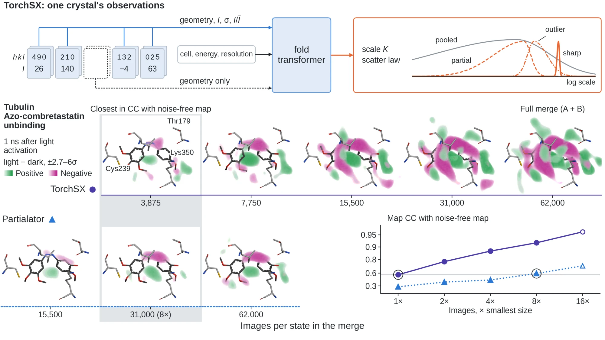

<p align="center">
  <picture>
    <source media="(prefers-color-scheme: dark)" srcset="https://raw.githubusercontent.com/HatPdotS/TorchSX/master/assets/torchsx-banner-dark.png">
    
  </picture>
</p>

<h1 align="center">A Py<ins>Torch</ins>-based scaling and merging library for serial crystallography (<ins>SX</ins>)</h1>

<div align="center">

[](https://www.python.org/downloads/)
[](https://pytorch.org/)
[](https://github.com/HatPdotS/TorchRef)
[](https://developer.nvidia.com/cuda-zone)
[](https://opensource.org/licenses/MIT)

</div>

TorchSX merges serial crystallography data with an error model learned for
every single observation instead of a few parameters per crystal. On the
time-resolved tubulin data below, its difference maps from 3,875 images per
state are as good as Partialator's from 31,000.

<p align="center">
  
</p>

**Top:** a fold transformer reads one crystal's observations together:
geometry, I, σ and I/Ī for most of them, geometry only for the fold whose
observations it is predicting, and the crystal's cell, energy and resolution.
For every observation it predicts a scale K and a scatter law, a mixture of
Gaussians in log intensity whose components cover pooled, partial, outlier
and sharp observations. **Bottom:** light-minus-dark difference maps of
azo-combretastatin unbinding from tubulin, 1 ns after light activation
(Wranik et al.<sup>[1](#references)</sup>), against the number of images per
state in the merge. The correlation with the noise-free map is estimated as
√CC, where CC is the correlation between the maps of two independent merges,
A and B, of disjoint images; open symbols are the full merge (A + B). Shaded: TorchSX with
3,875 images per state and Partialator with 31,000 (8×), the closest pair in
that correlation.

## What it does

- **Learns an error model per observation.** One network per dataset predicts,
  for every observation, a scale K (partiality, pulse intensity, crystal
  volume) and how far the measurement may plausibly fall from it.
- **Never uses an observation to predict itself.** Each crystal's observations
  are split into five folds. The network reads the whole crystal once per
  fold, with that fold's measurements hidden, and predicts the hidden ones
  from their geometry and the rest of the crystal. On the way it corrects the
  crystal's orientation and photon energy.
- **Merges by posterior, not by averaging.** Each reflection's intensity is
  integrated out under a Wilson prior. `F-obs` and `SIGF-obs` are the mean and
  standard deviation of the posterior of |F| given all its observations.
- **Cannot see light or dark.** The scale network is never given a state,
  delay or timepoint, so it cannot absorb a difference signal. One network
  serves all states, and each state is merged on its own.
- **Holds the merge at the sum of the spots.** A tether keeps the mean scale
  free of trends in resolution and direction, so partiality stays in K and the
  fall-off of the integrated intensities stays in the merged data.
- **Handles pseudo-translation.** Translational NCS, lattice translocation
  defects and stacking faults are found in the data and modelled in the prior
  and the scale model.

TorchSX reads integrated CrystFEL `.stream` files and probixi `.duckdb` runs
and writes merged MTZs. DIALS input is in progress. TorchSX is under active
development: if something behaves unexpectedly, please open an issue on GitHub.

The output works with any refinement or map program. Refinement and difference
maps in this repo were done with [TorchRef](https://github.com/HatPdotS/TorchRef)<sup>[2](#references)</sup>.

## Install

```bash
pip install torchsx
```

Python ≥ 3.10. This brings TorchRef 0.7, torch, triton, gemmi and
`torchsx-native`, the compiled `.stream` reader for your platform.

- **GPU.** TorchSX is meant to run on a GPU: its core algorithms are Triton
  kernels, and CPU runtime, or whether it runs on a CPU at all, has not been
  investigated.
- **GPU memory** should stay below 10 GB. It scales with the redundancy
  requested for training (default 100) and the number of unique reflections,
  not with the amount of data.
- **Host memory** does not scale with the amount of data either. The inputs
  are prepared block by block into an on-disk store of 56 bytes per
  observation, and training and merging read it one batch at a time, the next
  batch while the current one is computed.

From a checkout, build the native package first (needs Rust, see
[native/README.md](https://github.com/HatPdotS/TorchSX/blob/master/native/README.md)):
`pip install ./native`, then `pip install -e .`.

## Quick start

```bash
torchsx.train indexed.stream --spacegroup 'P 63' --dmin 2.0 -o run/
```

This trains the network (400 updates by default) and merges the data with it.
`run/` then contains:

```
run/
├── merged.mtz              merged amplitudes from all crystals
├── merged_half1.mtz        the same from one half of the crystals
├── merged_half2.mtz        ... and from the other half
├── merged.metrics.json     in-run precision: CC1/2 and R_split between the two halves
├── best.pt                 the network at the lowest validation loss; it made the merges
├── last.pt                 the network at the end of training
├── prepared/               the prepared observations on disk, reused by later runs on the same input
├── run.json                the resolved settings
├── training_summary.json   updates, best step, run time; time and GPU memory by phase
└── metrics.jsonl           training log: one line per update and per validation
```

Each MTZ holds:

| Column | MTZ type | Content |
|---|---|---|
| `H`, `K`, `L` | H | Miller index; Friedel mates merged |
| `F-obs` | F | posterior mean of the amplitude \|F\| |
| `SIGF-obs` | Q | posterior standard deviation of the amplitude |
| `R-free-flags` | I | refinement free set: 0 = free (5 %), 1 = work |

There are no intensity columns. `F-obs` is already the posterior estimate of
the amplitude, so it must not go through French–Wilson again; refinement
programs use it as it is. With `--no-merge-friedel` the mates stay apart and the
files carry `F-obs(+)`, `SIGF-obs(+)`, `F-obs(-)` and `SIGF-obs(-)`.
`--free-from earlier.mtz` takes the free set from an existing file.

The two halves split the crystals, not the training: both are merged with the
same network, so the CC1/2 and R_split in `merged.metrics.json` measure the
in-run precision, not the agreement of independent merges. For independent
halves, train two runs on disjoint sets of patterns.

### Light and dark

```bash
torchsx.train --split dark=dark.stream --split light=light.stream \
  --spacegroup 'P 63' --dmin 2.0 -o run/
```

One network is trained on both states, and each state is merged on its own:
`merged_dark.mtz` and `merged_light.mtz`, each with its two halves. A single
stream with a CrystFEL custom-split file works too (`--split-file`).

## The model

The signal that reached the detector aperture of observation *j* of
reflection *h* is

    S_j = K_j · I_h · exp(ε_j)

where I_h is the reflection's true intensity, a latent variable with a Wilson
prior; K_j is the predicted scale of this observation; and ε_j is a random
multiplicative scatter, with E[exp(ε_j)] = 1, whose distribution is also
predicted for this observation: a mixture of four Gaussians in log space, each
of which may be wider below its centre than above it, as the scatter of
partial observations is. The detector then records Poisson counts of S_j on
top of the background.

The network is trained on random batches of whole crystals, sized to a given
multiplicity (`--redundancy`, default 100), by maximising the marginal
likelihood of their observations with every I_h integrated out. No point
estimate of the intensity enters the loss, so the quantity that is scored is
the quantity that is merged. Like a weather forecaster scored on its
forecasts, the network is rewarded for confidence where the data agree and
penalised for it where they do not; a wider scatter costs likelihood, so
agreement cannot be bought by widening it. The integrals over I_h and ε_j run
in Triton kernels that never hold the full integrand in memory.

The [command-line reference](https://github.com/HatPdotS/TorchSX/blob/master/docs/cli.md#model)
describes the model, the tether and the pseudo-translation search in more
detail.

## Other commands

- `torchsx.merge run/best.pt more.stream -o merged.mtz` merges new or additional
  data with a trained network.
- `torchsx.merge-stats A/merged.mtz B/merged.mtz -o stats/` compares merges:
  completeness, CC1/2, R_split and, for light/dark pairs, the information in
  ΔF ([docs/merge_stats.md](https://github.com/HatPdotS/TorchSX/blob/master/docs/merge_stats.md)).
  `torchsx.merge-stats run/` finds the merges of each state in a run directory
  and writes `run/merge_stats/`.
- `torchsx.observation-stats indexed.stream --spacegroup 'P 63' -o figures/`
  plots the raw observations: intensity distributions, skewness, examples
  ([docs/stats.md](https://github.com/HatPdotS/TorchSX/blob/master/docs/stats.md)).

All options, gain and measurement settings, caching and reproducibility are in
the [command-line reference](https://github.com/HatPdotS/TorchSX/blob/master/docs/cli.md).

In Python, `torchsx.SFXStream.read('indexed.stream', spacegroup='P 63')` reads a
stream with its geometry and measurement settings.

## References

1. Wranik, M. et al. Watching the release of a photopharmacological drug from
   tubulin using time-resolved serial crystallography. *Nat. Commun.* **14**,
   903 (2023). [doi:10.1038/s41467-023-36481-5](https://doi.org/10.1038/s41467-023-36481-5)
2. Seidel, H.-P., Standfuss, J. & Weinert, T. TorchRef: an open-source PyTorch
   framework for crystallographic refinement. *J. Appl. Cryst.*, accepted (2026).

## License

MIT. See [LICENSE](https://github.com/HatPdotS/TorchSX/blob/master/LICENSE).
